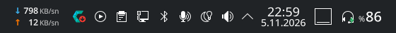
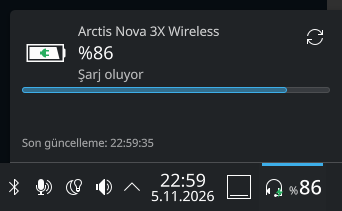
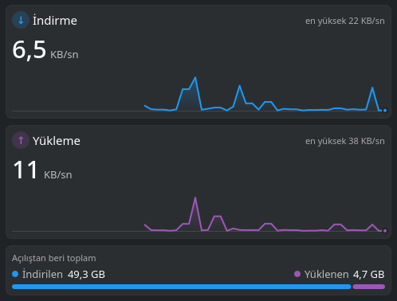
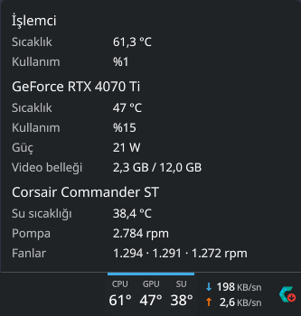

# cachyos-my-plugins

CachyOS (KDE Plasma 6) paneli için yazdığım küçük gereçler (plasmoid).

| Gereç | Ne yapar |
|---|---|
| [Kulaklık Pili](#kulaklık-pili) | Kablosuz kulaklığın pil yüzdesini panelde gösterir |
| [Ağ Trafiği](#ağ-trafiği) | Anlık indirme ve yükleme hızını panelde gösterir |
| [Sistem Durumu](#sistem-durumu) | İşlemci, ekran kartı ve sıvı soğutma sıcaklıklarını panelde gösterir |



---

## Kulaklık Pili

`kulaklik-pili/` — Kablosuz kulaklığın pilini [HeadsetControl](https://github.com/Sapd/HeadsetControl) ile okur.
SteelSeries Arctis Nova 3X Wireless ile denendi; HeadsetControl'ün pil okumayı desteklediği diğer kulaklıklarla da çalışması gerekir.



**Özellikler**

- Panelde kulaklık simgesi ve büyük rakamlarla yüzde (`%78`)
- Şarj olurken simgenin köşesinde yeşil şimşek rozeti
- Pil azalınca (varsayılan %15) kırmızı yazı ve bir kez masaüstü bildirimi
- Kulaklık kapalıyken ya da alıcı takılı değilken panelden gizlenir (düzenleme modunda görünür)
- Tıklayınca: büyük pil simgesi, yüzde, durum, ilerleme çubuğu ve yenile düğmesi
- Orta tık ya da sağ tık → **Şimdi yenile** ile anında okuma

**Ayarlar** (sağ tık → Yapılandır)

| Ayar | Varsayılan |
|---|---|
| Okuma aralığı | 60 sn |
| Düşük pil uyarısı | %15 |
| Kapalıyken gizle | Açık |

**Gereksinim:** `headsetcontrol` paketi. Paket, kulaklığa sudo'suz erişim için gereken udev kurallarını da kurar.

```sh
sudo pacman -S headsetcontrol
```

Kurduktan sonra kulaklığın alıcısını çıkarıp takın ve okumayı deneyin:

```sh
headsetcontrol -b
```

---

## Ağ Trafiği

`ag-trafigi/` — Tüm ağ arayüzlerinin toplam indirme/yükleme hızını gösterir.
Veriyi Plasma'nın kendi sistem izleme servisinden (`ksystemstats`) alır; komut çalıştırmaz, ek yük getirmez.



**Özellikler**

- Panelde iki satır: mavi `↓` indirme, mor `↑` yükleme
- Sabit genişlik: sayılar en fazla 3 karakter (`999`, `12`, `9,9`), panel titremez
- Bağlantı boştayken (< 1 KB/sn) sayılar soluklaşır
- Tıklayınca: sayarak değişen anlık hız, en yüksek hız ve son 60 saniyenin canlı grafiği (üzerine gelince değer); açılıştan beri toplamlar ve indirme/yükleme oran çubuğu

**Ayarlar** (sağ tık → Yapılandır)

| Ayar | Varsayılan |
|---|---|
| Güncelleme aralığı | 1000 ms |
| Birim | Bayt (KB/sn, MB/sn) — isteğe bağlı bit (Mbit/sn) |

**Gereksinim:** Ek paket gerekmez; Plasma 6 ile gelen `ksystemstats` yeterli.

---

## Sistem Durumu

`sistem-durumu/` — İşlemci, ekran kartı ve sıvı soğutma sıcaklıklarını gösterir.
İşlemci ve ekran kartı değerlerini `ksystemstats`'tan, sıvı soğutma değerlerini [liquidctl](https://github.com/liquidctl/liquidctl) ile okur.
AMD Ryzen, NVIDIA GeForce RTX 4070 Ti ve Corsair Commander ST ile denendi.



**Özellikler**

- Panelde üç blok: `CPU`, `GPU`, `SU` başlıkları altında büyük rakamlarla sıcaklık
- Sıcaklık yükselince renk değişir:

  | | Turuncu | Kırmızı |
  |---|---|---|
  | İşlemci | 85 °C | 95 °C |
  | Ekran kartı | 80 °C | 87 °C |
  | Su | 45 °C | 50 °C |

- Tıklayınca: işlemci kullanımı; ekran kartının adı, kullanımı, güç tüketimi ve video belleği; pompa ve fan devirleri
- Sıvı soğutma okuması varsayılan olarak kapalıdır; açıldığında ve cihaz bulunursa `SU` bloğu görünür

**Ayarlar** (sağ tık → Yapılandır)

| Ayar | Varsayılan |
|---|---|
| Panelde gösterilecekler | İşlemci, ekran kartı (sıvı soğutma kapalı) |
| Sıvı soğutma okuma aralığı | 5 sn |

**Gereksinim:** Sıvı soğutma için `liquidctl` paketi (isteğe bağlı). İşlemci ve ekran kartı için ek paket gerekmez.

> **Uyarı:** Corsair Commander Core/ST cihazları, `liquidctl` her okuma yaptığında yazılım moduna geçip
> donanım moduna geri döner ve bu sırada ışıklarını yeniden başlatır. Okuma açıkken ışıklar okuma
> aralığında bir sönüp yanar. Bu yüzden sıvı soğutma okuması varsayılan olarak kapalıdır.

```sh
sudo pacman -S liquidctl
liquidctl status
```

Ekran kartı olarak sistemdeki ilk GPU (`gpu0`) kullanılır.

---

## Kurulum

```sh
git clone https://github.com/codehakan/cachyos-my-plugins.git
cd cachyos-my-plugins

kpackagetool6 -t Plasma/Applet -i kulaklik-pili
kpackagetool6 -t Plasma/Applet -i ag-trafigi
kpackagetool6 -t Plasma/Applet -i sistem-durumu
```

Ardından panele sağ tık → **Gereç Ekle…** → "Kulaklık Pili", "Ağ Trafiği" ya da "Sistem Durumu" aratıp panele sürükleyin.

## Güncelleme

Kodda değişiklik yaptıktan sonra:

```sh
kpackagetool6 -t Plasma/Applet -u kulaklik-pili
kpackagetool6 -t Plasma/Applet -u ag-trafigi
kpackagetool6 -t Plasma/Applet -u sistem-durumu
```

Panelde zaten duran bir gerecin yeni halini görmek için Plasma'yı yeniden başlatın:

```sh
systemctl --user restart plasma-plasmashell.service
```

## Kaldırma

```sh
kpackagetool6 -t Plasma/Applet -r net.hakanakkaya.kulaklikpili
kpackagetool6 -t Plasma/Applet -r net.hakanakkaya.agtrafigi
kpackagetool6 -t Plasma/Applet -r net.hakanakkaya.sistemdurumu
```

## Hızlı deneme

Panele eklemeden ayrı bir pencerede açmak için:

```sh
plasmawindowed net.hakanakkaya.kulaklikpili
plasmawindowed net.hakanakkaya.agtrafigi
plasmawindowed net.hakanakkaya.sistemdurumu
```

QML hataları journal'a düşer:

```sh
journalctl --user -f | grep -i -E 'kulaklikpili|agtrafigi|sistemdurumu'
```

## Klasör yapısı

```
<gereç>/
├── metadata.json              # Gereç adı, kimliği, simgesi
└── contents/
    ├── config/
    │   ├── config.qml         # Ayarlar penceresinin sekmeleri
    │   └── main.xml           # Ayarlar ve varsayılan değerleri
    ├── images/                # (varsa) gerece özel görseller
    └── ui/
        ├── main.qml           # Panel görünümü ve açılır pencere
        └── configGeneral.qml  # Ayarlar sayfası
```

## Lisans

GPL-3.0
